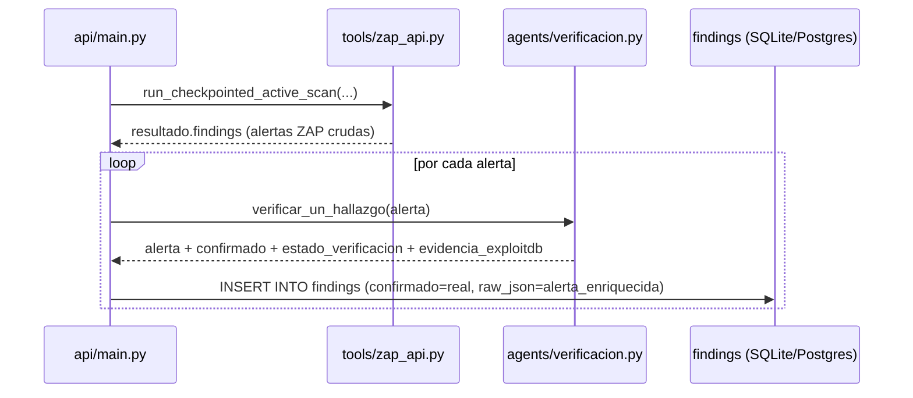
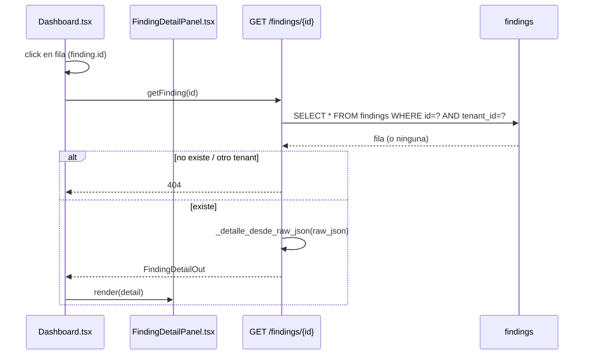

# Design: Fase 1 — Bucle de Detección visible

## Technical Approach

Reusar la verificación determinista ya escrita (`agents/verificacion.py`)
en el punto de inserción del escaneo activo, y exponer lo que ya se
persiste en `raw_json` a través de un endpoint de detalle curado y un panel
de frontend nuevo. Cero cambios de schema: todo lo nuevo se deriva de
columnas/campos existentes (ver Nota de DB abajo).

**Nota de DB (regla de `openspec/config.yaml`)**: este diseño **no agrega
columnas ni tablas**. `findings.estado_verificacion` como columna SQL
dedicada (dialecto portable SQLite+Postgres) es responsabilidad de
**fase0-fundaciones-datos**, corriendo en paralelo. Este diseño lee/escribe
esos datos exclusivamente dentro de `findings.raw_json` (columna `TEXT`, ya
existente, `db/schema.sql:111`), que ya es portable sin cambios.

## Architecture Decisions

### Decision: Exponer verificación como función pública por wrapper, no por rename

**Choice**: Agregar `verificar_un_hallazgo(hallazgo: dict) -> dict` en
`agents/verificacion.py` como función pública; `_verificar_un_hallazgo`
queda como implementación interna sin cambios, `node()` sigue llamando a la
privada (cero riesgo de romper el nodo del grafo).
**Alternatives considered**: (a) renombrar la privada directamente — riesgo
de romper cualquier referencia interna existente sin ganancia real; (b)
mover la lógica a `tools/` — no aplica, `verificacion.py` ya es la capa
correcta según su propio docstring (sección 7/8.1 del plan).
**Rationale**: mínimo diff, cero riesgo sobre el flujo ya probado (`POST /scan`).

### Decision: `raw_json` embebe el resultado de verificación completo

**Choice**: en `_correr_escaneo_activo_en_background`, reemplazar
`json.dumps(hallazgo)` por `json.dumps(hallazgo_verificado)` donde
`hallazgo_verificado = verificar_un_hallazgo(hallazgo)`. `confirmado` en la
columna SQL usa `int(bool(hallazgo_verificado["confirmado"]))` en vez del
`0` fijo actual (`api/main.py:1189-1216`).
**Alternatives considered**: guardar verificación en una columna JSON aparte
— innecesario, `raw_json` ya es el campo de trazabilidad completo por
convención del repo (ver `POST /scan`, línea 904, mismo patrón).
**Rationale**: consistencia con cómo ya se persiste `verified_findings` en
`POST /scan`; sin migración de datos históricos (findings viejos sin estos
campos simplemente no los tienen — el parser los tolera, ver abajo).

### Decision: `FindingDetailOut` como modelo nuevo, no extensión de `FindingOut`

**Choice**: nuevo modelo pydantic `FindingDetailOut`, endpoint
`GET /findings/{id}` separado de `GET /findings` / `GET /scans/{id}`.
**Alternatives considered**: agregar los campos nuevos directo a
`FindingOut` — rechazado: infla el payload de las listas (`GET /findings`,
usado por el resumen de riesgo del dashboard) con datos que la tabla no
necesita, y esos endpoints ya tienen consumidores en `Dashboard.tsx`
(`api.listFindings()`, `ScanDetail.findings`) que no deben cambiar de forma.
**Rationale**: principio de mínima sorpresa — un endpoint de detalle nuevo
es aditivo puro, cero riesgo de romper contratos existentes.

### Decision: parser tolerante `_detalle_desde_raw_json`

**Choice**: función helper en `api/main.py` que hace `json.loads(raw_json)`
con `try/except` (default `{}` si falla) y lee con `.get(...)` con defaults:
`descripcion=""`, `solucion=""`, `referencia=""`, `cwe=None`,
`estado_verificacion=None`, `cves_detectados=[]`, `evidencia_exploitdb=[]`.
**Rationale**: findings insertados antes de este cambio (sin
`estado_verificacion` ni claves ZAP nativas) deben servir 200 con defaults
vacíos, no 500.

### Decision (abierta): mapeo de `descripcion`/`solucion`/`referencia`/`cwe` por herramienta

**Confirmado**: para escaneo activo (`get_alerts()`, `tools/zap_api.py:355`)
y para `zap-baseline` (mismo formato de alerta ZAP, `agents/escaneo.py:68-70`
→ `raw.description/solution/reference/cweid`), el mapeo es directo:
`descripcion=raw.get("description")`, `solucion=raw.get("solution")`,
`referencia=raw.get("reference")`, `cwe=raw.get("cweid")`.
**No confirmado sin releer código de las herramientas** (`tools/scan.py`,
`run_nuclei`/`run_semgrep`/`run_trivy_image`/`run_grype`): el shape de
`raw` para `nuclei`/`semgrep`/`trivy`/`grype` (`agents/escaneo.py:61,82,91,98`)
no se verificó en esta sesión de diseño. **Ver Open Questions.**

## Data Flow

```
Escaneo activo (verificación insertada):

  ZAP daemon ──get_alerts()──> [alerta cruda] ──verificar_un_hallazgo()──> [alerta + confirmado/estado_verificacion/evidencia]
                                                                                   │
                                                                    INSERT INTO findings
                                                                    (confirmado=<real>, raw_json=<alerta enriquecida>)

Drill-down:

  Dashboard.tsx (click fila) ──GET /findings/{id}──> api/main.py
                                                          │
                                            SELECT * FROM findings WHERE id=? AND tenant_id=?
                                                          │
                                          _detalle_desde_raw_json(raw_json) ──> FindingDetailOut
                                                          │
                                    <── FindingDetailPanel.tsx renderiza
```

### Secuencia — escaneo activo con verificación



### Secuencia — drill-down de hallazgo



## File Changes

| File | Action | Description |
|------|--------|-------------|
| `agents/verificacion.py` | Modify | Agregar `verificar_un_hallazgo` público (wrapper de `_verificar_un_hallazgo`) |
| `api/main.py` | Modify | Nuevo `FindingDetailOut`, `_detalle_desde_raw_json()`, `GET /findings/{id}`; `_correr_escaneo_activo_en_background` usa `verificar_un_hallazgo` antes de insertar |
| `frontend/src/api.ts` | Modify | Nuevo tipo `FindingDetail`, método `api.getFinding(id)` |
| `frontend/src/components/FindingDetailPanel.tsx` | Create | Panel de detalle (overlay + tarjeta), props `{ findingId: string \| null; onClose: () => void }`, fetch on-demand al abrir vía `useEffect` |
| `frontend/src/pages/Dashboard.tsx` | Modify | `useState<string \| null>` para `findingIdAbierto`; `onClick` en `<tr>` de ambas tablas; render condicional de `<FindingDetailPanel>` |
| `frontend/src/index.css` | Modify | Estilos de overlay/panel; nuevas variantes de `.chip` si los 3 textos de verificación no caben en las clases existentes (`.chip.info` para no-verificable, `.chip.verificado` para confirmado, clase nueva `.chip.sin-poc` para CVE-sin-PoC) |
| `tests/test_finding_detail.py` | Create | `GET /findings/{id}`: 200 propio tenant, 404 ajeno/inexistente, 401 sin auth, defaults con `raw_json` viejo |
| `tests/test_verificacion_escaneo_activo.py` | Create | `verificar_un_hallazgo` aplicado antes de insertar en escaneo activo (mock de `run_checkpointed_active_scan`) |

## Interfaces / Contracts

```python
# agents/verificacion.py
def verificar_un_hallazgo(hallazgo: dict) -> dict:
    """Wrapper público de _verificar_un_hallazgo — mismo contrato, reusable
    fuera del grafo (ver api/main.py::_correr_escaneo_activo_en_background)."""
    return _verificar_un_hallazgo(hallazgo)
```

```python
# api/main.py
class FindingDetailOut(BaseModel):
    id: str
    scan_id: str
    tipo: str
    severidad: str
    endpoint: str
    confirmado: bool
    created_at: str
    descripcion: str = ""
    solucion: str = ""
    referencia: str = ""
    cwe: Optional[str] = None
    estado_verificacion: Optional[str] = None
    cves_detectados: list[str] = Field(default_factory=list)
    evidencia_exploitdb: list[dict] = Field(default_factory=list)


@app.get("/findings/{finding_id}", response_model=FindingDetailOut)
def detalle_finding(finding_id: str, user: UserContext = Depends(get_current_user)) -> FindingDetailOut:
    ...  # SELECT * FROM findings WHERE id=? AND tenant_id=?; 404 si no existe
```

```typescript
// frontend/src/api.ts
export type FindingDetail = Finding & {
  descripcion: string;
  solucion: string;
  referencia: string;
  cwe: string | null;
  estado_verificacion: string | null;
  cves_detectados: string[];
  evidencia_exploitdb: { cve: string; edb_id: string; descripcion: string }[];
};
// api.getFinding: (id: string) => request<FindingDetail>(`/findings/${id}`)
```

## Testing Strategy

| Layer | What to Test | Approach |
|-------|-------------|----------|
| Unit | `verificar_un_hallazgo` produce mismo resultado que `_verificar_un_hallazgo` | pytest directo sobre `agents/verificacion.py` |
| Unit | `_detalle_desde_raw_json` tolera JSON vacío/viejo | pytest con fixtures de `raw_json` con y sin campos nuevos |
| Integration | `GET /findings/{id}` scoping por tenant (200/404/401) | pytest + `tests/conftest.py` (mismo patrón que `test_multi_tenant_isolation.py`) |
| Integration | Escaneo activo persiste `confirmado` real, no `0` fijo | mock de `run_checkpointed_active_scan` devolviendo alertas con/sin CVE, assert sobre fila `findings` |
| Manual/E2E | Click de fila abre panel con datos correctos | verificación manual en `Dashboard.tsx` (no hay infra de frontend tests hoy, ver `openspec/config.yaml` context) |

## Migration / Rollout

No migración de datos. Findings existentes (insertados antes de este
cambio) seguirán sin `estado_verificacion` embebido en `raw_json` —
`GET /findings/{id}` los sirve igual con defaults (`estado_verificacion:
null`, listas vacías). Rollout es un deploy normal, sin flag necesario.

## Open Questions

- [x] **Shape de `raw` para nuclei/semgrep/trivy/grype** — RESUELTO en
  `sdd-apply` leyendo `tools/scan.py` y `tools/_shared.py` completos (no
  solo su docstring). Los shapes SÍ difieren de ZAP y entre sí; se
  implementó dispatch por `herramienta` en `_detalle_desde_raw_json`
  (`api/main.py`), mismo patrón que `normalize_severity`. Detalle real
  confirmado por herramienta:
  - **nuclei** (`run_nuclei`, JSONL): objeto plano con `template-id`,
    `host`, `matched-at`, e `info` (dict) con `name`/`severity`/
    `description`/`reference`/`classification`. `reference` puede ser
    string o lista; `classification.cwe-id` es lista. **No existe campo de
    "solución"** — las plantillas de nuclei no traen remediación
    estructurada, solo `description`. Confirmado contra
    `eval/severity_fixture_samples.json` (muestras reales capturadas en
    sesión previa) para el shape de `info`; `description`/`reference`/
    `classification` son el shape documentado y estable del schema JSONL
    de nuclei v3 (no recapturado con muestra real en ESTA sesión —
    ver nota de confianza abajo).
  - **semgrep** (`run_semgrep`, `results[]`): `check_id`, `path`, `extra`
    (dict) con `severity`/`message`/`metadata`. `metadata.references` es
    lista; `metadata.cwe` es lista (ej. `["CWE-89: ..."]`); no hay un
    campo `solution` dedicado — algunas reglas traen `metadata.fix` (string
    corto) o `extra.fix` (parche autofix), se usa como "solución" cuando
    existe. Mismo nivel de confianza que nuclei (shape documentado/estable,
    no recapturado en vivo esta sesión).
  - **trivy** (`run_trivy_image`, `Results[].Vulnerabilities[]`):
    `VulnerabilityID`, `PkgName`, `Title`, `Description`, `Severity`,
    `References` (lista), `CweIDs` (lista), `FixedVersion`. Se usa
    `FixedVersion` para sintetizar una "solución" ("Actualizar a la
    versión corregida: X"). Igual nivel de confianza que arriba.
  - **grype** (`run_grype`, `matches[]`): `vulnerability` (dict) con `id`,
    `severity`, `description` (a veces vacío), `urls` (lista), `fix`
    (dict con `versions`/`state`). **Grype no expone CWE en su schema de
    match** (a diferencia de Trivy) — `cwe` queda `None` a propósito, no
    inventado. Igual nivel de confianza que arriba.
  - **ZAP** (`zap-baseline`/`zap-full-scan` vía `tools/scan.py`, y alertas
    planas de `tools/zap_api.py::get_alerts()` para escaneo activo):
    mapeo directo ya confirmado antes de esta sesión —
    `description`/`solution`/`reference`/`cweid` a nivel superior de la
    alerta. Sin cambios.

  **Nota de confianza (documentado explícitamente, no en silencio, per
  encargo)**: a diferencia de `normalize_severity` — cuyos mapeos de
  severidad fueron verificados contra salida REAL capturada de cada
  herramienta (`eval/severity_fixture_samples.json`) — los campos
  `descripcion`/`solucion`/`referencia`/`cwe` de nuclei/semgrep/trivy/grype
  arriba están basados en el schema JSON documentado y estable de cada
  herramienta (estas claves no cambian entre versiones menores), pero NO
  se recapturó una corrida real en esta sesión de `sdd-apply` para
  confirmar esos nombres de campo bit a bit como si hizo la sesión de
  severidad. Riesgo residual: bajo (schemas públicos, ampliamente
  documentados, con solo `.get()` tolerante — un nombre de campo
  equivocado degrada a string vacío, nunca a 500). **Seguimiento
  recomendado**: si se quiere el mismo nivel de certeza que
  `normalize_severity`, correr cada herramienta en vivo una vez más y
  comparar `descripcion`/`referencia`/`cwe` extraídos contra la salida
  cruda, igual que se hizo para severidad.
- [x] El chip de verificación explicado reusa `.chip.info` (no-verificable)
  y `.chip.verificado` (confirmado), y agrega `.chip.sin-poc` (CVE sin PoC
  pública) — confirmado por el usuario antes de `sdd-apply`, sin necesidad
  de repreguntar.
