# Design: Fase 2b — Tablero de remediación (frontend)

## Technical Approach

Extender el Dashboard con un bloque de tablero de remediación (tabla +
filtros), extraído a un componente propio nuevo `RemediationBoard.tsx` que
consume `Finding` (extendido) y expone las mismas acciones de mutación que
hoy usa `Dashboard.tsx` (patrón `cargarTodo()` tras cada cambio exitoso).
Cero librerías nuevas: mismos primitivos (`.card`, `.chip`, `<select>`,
tabla HTML) ya usados en el resto del archivo. Badges de SLA y filtros son
funciones puras testeables, mismo patrón que `chipVerificacion` /
`nivelDeRiesgo` ya existentes.

## Decisión central: Tabla con filtros vs. Kanban con drag-and-drop

| Opción | Costo frontend | Cobertura del research (Secure.com lifecycle) | Riesgo |
|---|---|---|---|
| Kanban real (columnas por `estado`, drag-and-drop) | Alto: librería DnD nueva (viola restricción "cero librerías nuevas" o DnD nativo HTML5 propio, frágil), estado de layout complejo, accesibilidad de teclado a construir desde cero | Cubre el lifecycle igual de bien — el research pide visibilidad de estado/dueño/SLA, no específicamente drag-and-drop | Alto: superficie nueva grande en un archivo/componente que hoy no tiene tests de frontend |
| **Tabla con filtros (elegida)** | Bajo: reusa `<table>`, `.chip`, patrón de filtro-por-chip ya usado para severidad | Cubre el mismo lifecycle (Descubrir→Triage→Asignar→Remediar→Verificar→Cerrar) vía filtro de `estado` + cambio inline, sin exigir reordenar visualmente | Bajo: cambio de estado es un `<select>`, no un gesto; degrada con gracia si el PATCH real difiere |

**Decision**: tabla con filtros (estado, dueño, SLA) + selects inline para
mutar `estado`/`owner_user_id`.
**Alternatives considered**: kanban real con drag-and-drop.
**Rationale**: el proposal ya lo señala y el research citado en el plan
(Secure.com) describe el lifecycle como una secuencia de estados con
dueño y SLA — no exige una interacción de arrastre para ser efectivo. Un
analista de seguridad triagea principalmente por severidad/SLA/dueño (texto,
números, orden), no por reordenamiento espacial; el 80% del valor (visibilidad
+ capacidad de actuar) se logra con filtros + edición inline a una fracción
del esfuerzo y sin introducir una dependencia de UI nueva. Si el research de
uso real (fuera de esta ronda) mostrara que los analistas prefieren
arrastrar tarjetas, esa es una iteración posterior aislada (nuevo componente,
mismo modelo de datos).

## Contrato ASUMIDO de fase2a (a confirmar antes de `sdd-apply`)

**No confirmado contra el design.md real de `fase2a-ciclo-vida-hallazgo`** —
ese change está en diseño paralelo sin código ni documento accesible en este
momento. Este change asume:

```
PATCH /findings/{id}
Request body: { estado?: string, owner_user_id?: string, nota?: string }
Response 200: finding actualizado (shape mínimo esperado: al menos
              { id, estado, owner_user_id, sla_due_at } — se asume superset
              compatible con `Finding` extendido, ver Interfaces abajo)
Errores esperados: 400 (estado inválido / transición no permitida),
              404 (finding ajeno/inexistente), 401 (sin auth)
```

**También asumido**: `GET /findings` (lista) se extiende para incluir
`estado`, `owner_user_id`, `sla_due_at` por item — hoy `Finding` en
`api.ts` no los tiene. Sin esa extensión el tablero no tiene datos para
filtrar/mostrar (ver spec.md, "Degradación cuando GET /findings no expone
los campos nuevos").

**Punto único de ajuste si el contrato real difiere**: `frontend/src/api.ts`
(tipo `Finding`, tipo `PatchFindingBody`, función `api.patchFinding`) y el
punto de consumo en `RemediationBoard.tsx` (manejo de la respuesta/errores).
`Dashboard.tsx` no debería necesitar cambios más allá de pasar props.

## Función pura: badge de SLA

```typescript
// frontend/src/components/RemediationBoard.tsx (o utils compartido)
type SlaBadge = { texto: string; clase: string };

function badgeSla(slaDueAt: string | null, ahora: Date = new Date()): SlaBadge {
  if (!slaDueAt) return { texto: "sin SLA", clase: "info" };
  const vence = new Date(slaDueAt);
  const diffMs = vence.getTime() - ahora.getTime();
  const diffDias = Math.ceil(diffMs / (1000 * 60 * 60 * 24));
  if (diffDias < 0) return { texto: "SLA vencido", clase: "sla-vencido" };
  if (diffDias <= 3) return { texto: `vence en ${diffDias}d`, clase: "sla-proximo" };
  return { texto: `vence en ${diffDias}d`, clase: "sla-ok" };
}
```

Umbral "próximo" = 3 días (mismo valor citado en spec.md; ajustable a
config de tenant en una fase posterior, fuera de este alcance). Casos
borde: `slaDueAt` inválido (`isNaN(vence.getTime())`) se trata igual que
`null` (degradar a "sin SLA", nunca lanzar). Clases CSS nuevas
`.chip.sla-vencido` (mapea a `--alert`/`--alert-bg`), `.chip.sla-proximo`
(mapea a `--accent`/`--accent-bg`), `.chip.sla-ok` (mapea a
`--verified`/`--verified-bg`) — mismo patrón de `index.css` ya existente.

## Decisión: componente extraído vs. inline

**Choice**: nuevo `frontend/src/components/RemediationBoard.tsx`, importado
por `Dashboard.tsx` igual que `FindingDetailPanel`/`Equipo`/`ScanHistoryChart`.
**Alternatives considered**: agregar el bloque directo dentro del `return`
de `Dashboard.tsx` (patrón usado hoy para "Hallazgos detectados").
**Rationale**: `Dashboard.tsx` ya tiene 843 líneas; este tablero agrega
filtros de estado/dueño/SLA + selects inline + lógica de refetch/revert, un
bloque de tamaño comparable al que ya tiene su propio archivo
(`FindingDetailPanel.tsx`, 194 líneas). Extraerlo mantiene `Dashboard.tsx`
como orquestador de datos (fetch, estado global) y saca la lógica de
presentación/filtrado a un componente con su propio estado local de
filtros, siguiendo el precedente ya sentado por Fase 1.

## Data Flow — cambio de estado/dueño

```mermaid
sequenceDiagram
    participant UI as RemediationBoard.tsx
    participant API as api.patchFinding (asumido)
    participant BE as PATCH /findings/{id} (fase2a, asumido)

    UI->>UI: usuario cambia <select> de estado/dueño
    UI->>UI: guarda valor anterior confirmado (para revertir)
    UI->>API: patchFinding(id, { estado | owner_user_id })
    API->>BE: PATCH /findings/{id}
    alt 200 OK
        BE-->>API: finding actualizado
        API-->>UI: resultado
        UI->>UI: refetch listFindings() (mismo patrón que cargarTodo())
        UI->>UI: fila muestra el nuevo valor confirmado
    else error (400/404/401/red)
        BE-->>API: error
        API-->>UI: ApiError
        UI->>UI: setMensaje(error) -- mismo patrón que el resto de Dashboard.tsx
        UI->>UI: select vuelve al valor anterior confirmado (no al intentado)
    end
```



## File Changes

| File | Action | Description |
|------|--------|--------------|
| `frontend/src/api.ts` | Modify | `Finding` extendido con `estado?`, `owner_user_id?`, `sla_due_at?` (opcionales, ver degradación); nuevo tipo `PatchFindingBody`; nuevo `api.patchFinding(id, body)` |
| `frontend/src/components/RemediationBoard.tsx` | Create | Tabla + filtros (estado/dueño/SLA) + selects inline + badges de SLA + manejo de error/revert |
| `frontend/src/pages/Dashboard.tsx` | Modify | Importar y renderizar `<RemediationBoard findings={findings} members={members} onChanged={cargarTodo} />`; nuevo fetch de `api.listMembers()` en `cargarTodo()` |
| `frontend/src/index.css` | Modify | `.chip.sla-vencido`, `.chip.sla-proximo`, `.chip.sla-ok` |

## Interfaces / Contracts

```typescript
// frontend/src/api.ts
export type Finding = {
  id: string;
  scan_id: string;
  tipo: string;
  severidad: "critical" | "high" | "medium" | "low" | "info";
  endpoint: string;
  confirmado: boolean;
  created_at: string;
  // Asumido de fase2a — opcionales hasta confirmar que GET /findings los expone.
  estado?: "descubierto" | "triage" | "asignado" | "en_progreso" | "mitigado" | "verificado" | "cerrado" | "aceptado_riesgo";
  owner_user_id?: string | null;
  sla_due_at?: string | null;
};

export type PatchFindingBody = {
  estado?: Finding["estado"];
  owner_user_id?: string | null;
  nota?: string;
};

// api.patchFinding: (id: string, body: PatchFindingBody) => request<Finding>(`/findings/${id}`, { method: "PATCH", body: JSON.stringify(body) })
```

## Testing Strategy

| Layer | What to Test | Approach |
|-------|-------------|----------|
| Unit | `badgeSla` clasifica vencido/próximo/ok/sin-SLA/fecha inválida | test puro sobre la función (fecha fija inyectada como `ahora`) |
| Unit | Filtros (estado/dueño/SLA) sobre un array fijo de `Finding` | test puro, sin red |
| Manual/E2E | Cambio de estado exitoso refleja el nuevo valor tras refetch | verificación manual en `Dashboard.tsx` (no hay infra de frontend tests hoy, mismo gap señalado en `fase1-deteccion-visible/design.md`) |
| Manual/E2E | PATCH fallido muestra error y revierte el select | verificación manual simulando 500/red |

## Migration / Rollout

No migración de datos (fase0 ya aplicó el schema). Rollout es aditivo: si
`fase2a` aún no expone `PATCH /findings/{id}` ni los campos nuevos en
`GET /findings` al momento del deploy, `RemediationBoard.tsx` se renderiza
en modo solo-lectura degradado (badges "sin SLA", selects deshabilitados)
según el escenario de `spec.md`. No requiere flag: la ausencia de campos en
la respuesta es la señal natural de degradación.

## Open Questions

- [ ] **Contrato real de fase2a** — bloqueante para habilitar escritura
  (selects de estado/dueño). Confirmar `PATCH /findings/{id}` shape exacto
  y si `GET /findings` incluirá los 3 campos nuevos, antes de `sdd-apply`.
- [ ] Umbral "próximo" (3 días) — confirmar si debe ser configurable por
  severidad/tenant o si el valor fijo es aceptable para v1.
- [ ] ¿`api.listMembers()` requiere rol mínimo (ej. admin) que un analista
  sin ese rol no tenga? Si el endpoint 403 para roles bajos, el filtro de
  dueño debe degradar a "sin datos de dueño" en vez de romper — no
  verificado en esta sesión de diseño (fuera del alcance de lectura de
  `api/main.py`, restringido a `frontend/**`).
