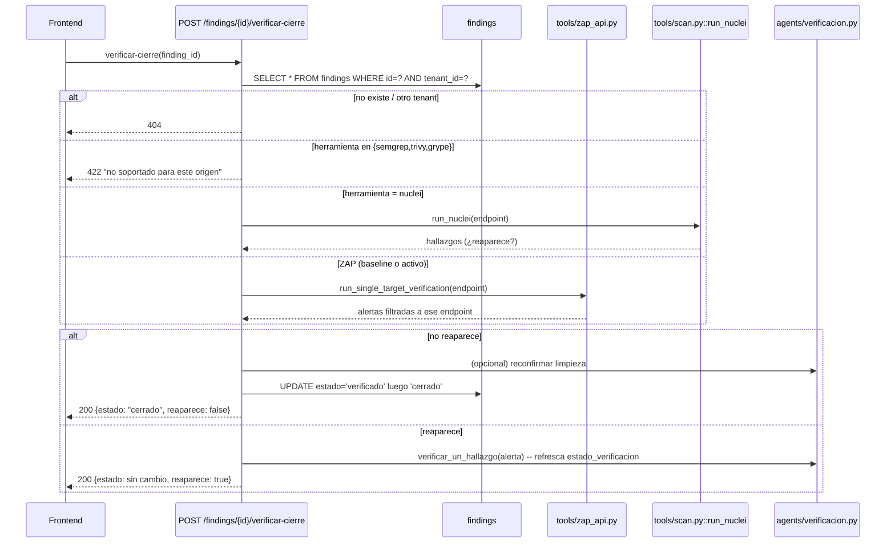

# Design: Verificación de cierre y KPIs de remediación

## Technical Approach

Dos capacidades aditivas que reusan infraestructura ya probada:
(1) un modo "single-target" nuevo en `tools/zap_api.py` + reuso directo de
`run_nuclei` para re-escanear solo el endpoint de un hallazgo, con
transición automática de estado cuando ya no reproduce; (2) `GET /kpis`
que agrega sobre `findings` con el mismo patrón "parser tolerante + modelo
pydantic nuevo" de `fase1-deteccion-visible`. Cero columnas SQL nuevas —
reusa lo que `fase0`/`fase2a` ya dejan en `findings`. Los cálculos de MTTR
se hacen **en Python** sobre timestamps ya traídos con `SELECT`, no con
funciones SQL de fecha (evita `julianday()` de SQLite vs `EXTRACT(EPOCH
FROM ...)` de Postgres — ninguna es portable entre motores).

> **Actualizado durante `sdd-apply` (post-merge de `fase2a`/`fase2b` a
> `main`):** este design.md se escribió en paralelo con `fase2a` y dejaba
> el MTTR en modo "aproximado" (`ultima_vez_visto`/`created_at`) como
> salvavidas explícito por si esa fase no llegaba a persistir un historial
> de transiciones con timestamp exacto (ver Open Question #1 original, más
> abajo). Al aplicar este change, `fase2a-ciclo-vida-hallazgo` ya estaba
> mergeado y CONFIRMADO en vivo (`tests/test_finding_patch.py`,
> `tests/test_drift_reincidencia.py`) persistiendo `finding_transiciones`
> con `created_at TIMESTAMP NOT NULL DEFAULT CURRENT_TIMESTAMP` real en
> cada transición, manual (`PATCH /findings/{id}`) o automática (drift).
> Por eso el MTTR implementado usa **precisión real**, no la aproximación:
> para cada finding, se toma el timestamp de su primera fila en
> `finding_transiciones` con `estado_nuevo='cerrado'` menos
> `findings.created_at` (ambos parseados con `_parse_dt_utc_naive` en
> `api/main.py`, que normaliza el formato mixto de timestamp entre
> inserciones manuales -- `DEFAULT CURRENT_TIMESTAMP`, sin offset -- y
> automáticas -- ISO explícito con offset). `precision` en la respuesta de
> `GET /kpis` es `"exacto"` siempre. El resto de este documento (secciones
> de abajo) describe la decisión que se HABRÍA tomado si `fase2a` no
> hubiera persistido ese historial -- se deja tal cual para trazabilidad de
> la decisión original, no describe el comportamiento realmente
> implementado.
>
> También se actualizó el punto de montaje real del botón "verificar
> arreglo": `fase2b-tablero-remediacion` sí aplicó `RemediationBoard.tsx`
> con una fila por hallazgo (el "Open Question #2" de abajo especulaba con
> un fallback standalone si no existiera ese punto de montaje) -- el botón
> se insertó ahí, en una columna "Acciones" nueva, visible solo cuando
> `estado` es `mitigado` o `verificado`.

## Architecture Decisions

### Decision: Single-target ZAP sin spider previo, dentro de una función nueva

**Choice**: `run_single_target_verification(target_url, endpoint_url,
bearer_token, scan_id, on_progress=None)` en `tools/zap_api.py` — arranca
daemon (`start_daemon`/`wait_ready`, reuso directo), llama
`ascan_start(base_url, endpoint_url, recurse=False)` directo (sin
`spider_start`/`ajax_spider_start`), poll corto de `ascan_status`, y
`get_alerts(base_url, baseurl=endpoint_url)` filtrando ya al endpoint
exacto. Limpia el daemon en `finally`, igual que
`run_checkpointed_active_scan`.
**Alternatives considered**: (a) reusar `run_checkpointed_active_scan`
completo apuntando `target_url=endpoint_url` — descartado, corre spider +
AJAX spider innecesarios (caro, y AJAX spider levanta un navegador headless
solo para 1 URL ya conocida); (b) hacer `ascan_start(..., recurse=True)`
sobre el endpoint — descartado, recurse=true expande a todo lo que cuelgue
de esa URL, contradice "solo ese endpoint".
**Rationale**: mínimo trabajo por verificación de cierre (se espera que se
llame frecuentemente, uno por hallazgo), reusando el daemon/cleanup ya
probado.

### Decision: `ascan_start` gana un parámetro `recurse: bool = True`

**Choice**: `ascan_start(base_url, target_url, recurse: bool = True)`,
serializa a `"true"`/`"false"` en el param `recurse` de la API de ZAP.
Default `True` preserva el comportamiento actual de
`run_checkpointed_active_scan` sin tocar su call site.
**Rationale**: cambio aditivo de un parámetro con default retrocompatible
— cero riesgo sobre el flujo de escaneo activo completo existente.

### Decision: Dispatch por herramienta de origen, 3 vías

**Choice**: en `POST /findings/{id}/verificar-cierre`, leer
`herramienta` de `raw_json` (o inferir "zap-activo" si no hay wrapper,
mismo criterio que `_detalle_desde_raw_json` de fase1): `nuclei` →
`run_nuclei(endpoint)`; `zap-baseline`/ausente (ZAP plano) →
`run_single_target_verification`; `semgrep`/`trivy`/`grype` → 422
inmediato, sin tocar red/Docker.
**Rationale**: mismo patrón de dispatch ya usado por
`_detalle_desde_raw_json` — un `if/elif` legible, no una tabla de
estrategia sobre-diseñada para 3 casos.

### Decision: Transición de estado reusa el vocabulario de `fase2a`, no inventa uno nuevo

**Choice**: este endpoint solo hace `UPDATE findings SET estado='verificado'`
y luego `estado='cerrado'` (dos updates secuenciales, mismos valores del
CHECK constraint ya en `db/schema.sql`) — no llama al `PATCH
/findings/{id}` de `fase2a` para evitar acoplar el orden de aplicación
(este change se aplica DESPUÉS, pero no debe *depender en tiempo de
ejecución* de que ese endpoint específico exista con cierta firma).
**Rationale**: acopla solo al *dato* (columna `estado`, ya en `fase0`), no
a la *API* de `fase2a` — reduce el riesgo de incompatibilidad señalado en
el proposal.

### Decision: KPIs calculados en Python, no en SQL con funciones de fecha

**Choice**: `GET /kpis` hace `SELECT id, severidad, estado, created_at,
sla_due_at, ultima_vez_visto FROM findings WHERE tenant_id=?` (y un JOIN
liviano con `scans` para `asset_id`/fecha por tendencia), y calcula MTTR /
% SLA / series en Python con `datetime.fromisoformat`.
**Alternatives considered**: `julianday(ultima_vez_visto) -
julianday(created_at)` (SQLite) o `EXTRACT(EPOCH FROM ...)` (Postgres) —
descartado, exigiría dos queries distintas por motor (`db/connection.py`
ya distingue motores para otros casos, pero aquí se evita el problema de
raíz).
**Rationale**: portable de verdad sin ramificar por motor; el volumen de
`findings` por tenant es bajo (decenas/cientos), agregación en Python es
barata.

## Data Flow — Verificar cierre



## File Changes

| File | Action | Description |
|------|--------|-------------|
| `tools/zap_api.py` | Modify | `ascan_start(..., recurse: bool = True)`; nueva `run_single_target_verification(...)` |
| `api/main.py` | Modify | `POST /findings/{id}/verificar-cierre` + `GET /kpis`, modelos `VerificarCierreOut`, `KpiOut` |
| `frontend/src/api.ts` | Modify | Tipos `VerificarCierreResult`, `KpiSummary`; `api.verificarCierre(id)`, `api.getKpis()` |
| `frontend/src/pages/Dashboard.tsx` o `frontend/src/components/KpiWidget.tsx` | Modify/Create | Widget de 3 KPIs; ver Open Questions sobre punto de montaje de `fase2b` |
| `tests/test_verificar_cierre.py` | Create | Dispatch por herramienta, 404 cross-tenant, 422 sin soporte, transición automática |
| `tests/test_kpis.py` | Create | MTTR con/sin datos, % SLA con 0 abiertos, tendencia por asset |

## Interfaces / Contracts

```python
# api/main.py
class VerificarCierreOut(BaseModel):
    finding_id: str
    estado: str
    reaparece: bool
    detalle: str

class KpiSeveridad(BaseModel):
    severidad: str
    mttr_dias: Optional[float] = None
    precision: str = "aproximado"  # o "exacto" si fase2a provee historial

class KpiTendenciaAsset(BaseModel):
    asset_id: str
    puntos: list[dict]  # [{"fecha": ..., "critical": N, "high": N, ...}]

class KpiOut(BaseModel):
    mttr_por_severidad: list[KpiSeveridad]
    porcentaje_dentro_sla: Optional[float] = None
    tendencia_por_activo: list[KpiTendenciaAsset]
```

```typescript
// frontend/src/api.ts
export type KpiSummary = {
  mttr_por_severidad: { severidad: string; mttr_dias: number | null; precision: string }[];
  porcentaje_dentro_sla: number | null;
  tendencia_por_activo: { asset_id: string; puntos: Record<string, unknown>[] }[];
};
```

## Testing Strategy

| Layer | What to Test | Approach |
|-------|-------------|----------|
| Unit | Dispatch por `herramienta` (nuclei/zap/no-soportado) | pytest con `raw_json` fixtures de cada herramienta |
| Unit | MTTR con 0 hallazgos cerrados devuelve `null` | pytest directo sobre el cálculo |
| Integration | 404 cross-tenant, 422 semgrep/trivy/grype | pytest + `tests/conftest.py`, mismo patrón que `test_finding_detail.py` |
| Integration | Transición automática verificado→cerrado (mock de ZAP/nuclei) | mock `run_single_target_verification`/`run_nuclei` |
| Manual | ZAP `ascan(recurse=False)` sobre URL sin spidering previo | correr una vez contra Juice Shop real antes de confiar en el diseño (ver Open Questions) |

## Migration / Rollout

No migración. Endpoints aditivos. Rollout normal tras confirmar que
`fase2a`/`fase2b` están aplicados (gate del orquestador, no de este
código).

## Open Questions / Dependencies

1. **Sobre `fase2a`**: se asume que provee (a) el mismo vocabulario de
   `estado` ya en `db/schema.sql` (confirmado, no depende de fase2a en sí
   — ya existe desde fase0), y (b) transiciones vía `PATCH
   /findings/{id}`. **No se asume** que persista historial de
   transiciones con timestamp exacto — si `fase2a` NO lo agrega, el MTTR
   de este change queda `precision: "aproximado"` permanentemente (usando
   `ultima_vez_visto`/`created_at`), lo cual está soportado por diseño
   desde el día uno, no es un fallback de emergencia. Si `fase2a` SÍ
   agrega esa tabla, este endpoint debería actualizarse (fuera de scope de
   este change) para usarla y reportar `precision: "exacto"`.
2. **Sobre `fase2b`**: se asume que provee una vista de tablero/tabla
   donde insertar el botón "verificar arreglo" por fila. **Si ese punto de
   montaje no existe o tiene un shape distinto** al esperado, el fallback
   es un widget standalone nuevo (`KpiWidget.tsx` + sección propia en
   `Dashboard.tsx`, mismo patrón de card que el resto de la página) — no
   bloquea la entrega de este change.
3. **Incertidumbre real sobre ZAP -- resultado de la sesión de `sdd-apply`**:
   el plan (task 1.1 de tasks.md) era levantar Juice Shop + un daemon ZAP
   real y confirmar en vivo si `ascan(recurse=False)` funciona sobre una
   URL nunca visitada por el spider. **No se pudo ejecutar ese spike**: el
   entorno sandbox de esta sesión tiene el CLI de Docker instalado
   (`docker --version` responde) pero el daemon de Docker Desktop no
   estaba corriendo (`docker ps` devolvió `error during connect ... the
   system cannot find the file specified` contra el pipe de Docker
   Desktop) -- no hay forma de levantar un contenedor real en este entorno.
   Decisión tomada con el mejor entendimiento disponible, leyendo el código
   de `tools/zap_api.py` (no se degradó a "no soportado" ni se dejó la
   pregunta abierta en silencio): `run_single_target_verification` llama
   `access_url(base_url, endpoint_url)` -- la acción real
   `/JSON/core/action/accessUrl/` de la API de ZAP, que le pide al propio
   ZAP que visite la URL y la registre en su Sites tree -- **antes**,
   siempre, de `ascan_start(recurse=False)`. Es la misma mitigación barata
   que ya preveía este documento, aplicada por defecto en vez de
   condicionada a un spike que no se pudo correr: una sola llamada HTTP más
   a la propia API de ZAP, sin costo si el registro no hacía falta. Si una
   sesión futura SÍ levanta Docker Desktop y confirma que esto era
   innecesario (o insuficiente), debe actualizar este párrafo y el
   docstring de `run_single_target_verification` con el resultado real --
   no asumir "confirmado" a partir de este texto.
4. **Hallazgos semgrep/trivy/grype**: quedan explícitamente fuera del
   re-escaneo automático de cierre (422 documentado) — no es un bug ni un
   TODO, es una limitación de dominio (código/imagen no tiene un
   "endpoint" HTTP puntual que re-escanear).
