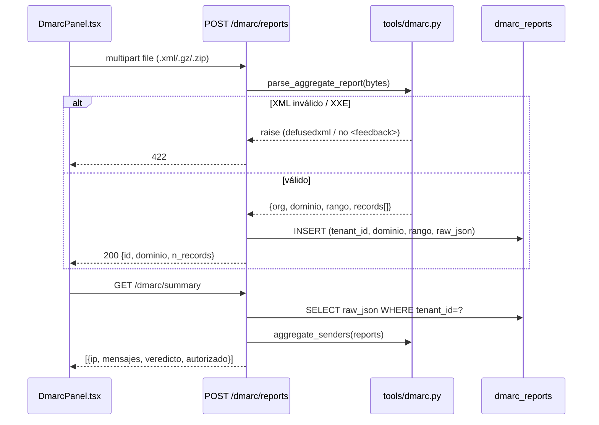

# Design: Monitoreo DMARC

## Technical Approach

Tres capacidades aditivas que reusan el patrón ya probado por
`fase1-deteccion-visible`/`fase2c`: **parser tolerante sobre bytes →
`raw_json` normalizado en `dmarc_reports` → agregación en Python en lectura**.
Cero columnas/tablas SQL nuevas (la tabla `dmarc_reports` de Fase 0 alcanza),
cero funciones SQL de fecha (parseo de rangos en Python, mismo motivo que
`fase2c`: portabilidad SQLite/Postgres). La ingesta es por **upload manual**
del XML que el usuario ya recibe en su propio buzón `rua=` — cero infra nueva.
La "autorización" de un remitente se **deriva del propio veredicto DMARC del
reporte** (SPF o DKIM alineado), no de una lista que Vigia deba mantener.

## Architecture Decisions

### Decision: Ingesta por upload manual, no buzón de email dedicado

| Opción | Tradeoff | Decisión |
|--------|----------|----------|
| Upload manual (`POST /dmarc/reports` con archivo) | Un paso manual del usuario; cero infra | **Elegida (v1)** |
| Buzón dedicado + poller IMAP | Auto-ingesta, pero exige dirección, credenciales, worker de larga duración, parseo MIME/adjuntos | Diferida (Out of Scope) |

**Rationale**: el dato es idéntico por ambas vías; el usuario apunta su
`rua=mailto:` a su propio buzón (donde ya llegan por config DNS de su
dominio) y sube el XML. El buzón dedicado es el mismo tipo de proceso de
larga duración que `certstream_listener` — mucha infra para un v1. El upload
deja la puerta abierta a automatizar la ingesta luego contra el MISMO parser.

### Decision: Parseo XML con defusedxml, nunca `xml.etree` directo

**Choice**: `tools/dmarc.py` usa `defusedxml.ElementTree` (nueva dependencia).
**Alternatives considered**: stdlib `xml.etree.ElementTree` — descartado: un
reporte RUA es entrada NO confiable (cualquiera puede mandar un XML manipulado
al buzón `rua=` del cliente, que este luego sube). `xml.etree` es vulnerable a
XXE y billion-laughs.
**Rationale**: coherente con la postura de seguridad del proyecto (auth/tenant
scoping, Ley 1273). El costo es una dep pequeña y ubicua. Test explícito con
payload XXE.

### Decision: `raw_json` como store, agregación en lectura (sin tabla de records)

**Choice**: cada reporte = una fila `dmarc_reports` cuyo `raw_json` guarda
metadatos + lista de `records` normalizados. `GET /dmarc/summary` lee las
filas del tenant, parsea `raw_json` en Python y agrega por IP de origen.
**Alternatives considered**: tabla `dmarc_records` (una fila por IP/record) —
descartado: exige migración + reconciliación SQLite/Postgres en
`db/connection.py` (patrón `_ensure_*_columns`), y el volumen por tenant es
bajo. Mismo criterio de "sin tabla nueva" que `fase2c`.
**Rationale**: sin migración, retrocompatible, y la agregación en Python evita
`julianday()`/`EXTRACT` no portables.

### Decision: `python-multipart` para `UploadFile`

**Choice**: endpoint recibe `UploadFile` (requiere `python-multipart`).
**Alternatives considered**: leer `await request.body()` crudo — evita la dep
pero da peor UX (el file-picker del navegador manda multipart por defecto) y
complica adjuntos binarios `.gz`/`.zip`. **Rationale**: dep aditiva, ubicua,
sin efecto sobre rutas existentes.

### Decision: Aislamiento en archivos propios, solo añadidos en los compartidos

Toda la lógica de dominio vive en archivos NUEVOS (`tools/dmarc.py`,
`DmarcPanel.tsx`, `tests/test_dmarc.py`). En los archivos COMPARTIDOS con
changes hermanos (`api/main.py`, `frontend/src/api.ts`,
`frontend/src/pages/Dashboard.tsx`, `pyproject.toml`) este change solo
**añade** bloques (rutas, modelos, tipos, montaje, deps) — no modifica
contratos existentes. Reduce el conflicto de merge a hunks aditivos que el
orquestador secuencia.

## Data Flow



## File Changes — lo que tocará `sdd-apply` (manifiesto para el orquestador)

| File | Action | Tipo | Descripción |
|------|--------|------|-------------|
| `tools/dmarc.py` | Create | **propio** | `parse_aggregate_report(data: bytes)`, `aggregate_senders(reports)`; descompresión gz/zip, defusedxml |
| `tests/test_dmarc.py` | Create | **propio** | parser, XXE-safety, tenant scoping, agregación |
| `frontend/src/components/DmarcPanel.tsx` | Create | **propio** | upload + lista reportes + tabla remitentes no autorizados |
| `pyproject.toml` | Modify (aditivo) | **compartido** | +`defusedxml`, +`python-multipart` en `dependencies` |
| `api/main.py` | Modify (aditivo) | **compartido** | 3 rutas (`POST /dmarc/reports`, `GET /dmarc/reports`, `GET /dmarc/summary`) + modelos `DmarcReportOut`, `DmarcIngestOut`, `DmarcSenderOut`; import de `tools.dmarc` |
| `frontend/src/api.ts` | Modify (aditivo) | **compartido** | tipos `DmarcReport`, `DmarcSender`, `DmarcIngestResult`; métodos `api.uploadDmarcReport(file)` (FormData), `api.getDmarcReports()`, `api.getDmarcSummary(dominio?)` |
| `frontend/src/pages/Dashboard.tsx` | Modify (aditivo) | **compartido** | monta `<DmarcPanel/>` (mismo patrón de card que `KpiWidget`/`RemediationBoard`) |

**NO se toca**: `db/schema.sql` ni `db/connection.py` (tabla ya existe, sin
columnas nuevas). `tools/antisuplantacion.py` (dominio distinto: lookalikes,
no reportes). `vigia_core_private/`.

**Nota de coordinación (siblings en paralelo)**: `api/main.py`,
`frontend/src/api.ts`, `Dashboard.tsx` y `pyproject.toml` los tocan también
`fase3a`/`fase3b`/`fase4`+. Este change no puede ver sus diseños. Todos sus
cambios en esos 4 archivos son **puramente aditivos** (rutas/tipos/deps
nuevos, sin editar líneas existentes) → si el orquestador aplica los changes
en serie, los conflictos deberían ser resolubles como hunks adyacentes. `api.ts`
tiene un helper `request<T>` (que fija JSON) y `downloadFile` (binario); el
upload usa `fetch` con `FormData` directo (sin `Content-Type` manual, el
navegador lo pone) reutilizando `getToken()` para el `Authorization`.

## Interfaces / Contracts

```python
# tools/dmarc.py
def parse_aggregate_report(data: bytes) -> dict:
    """data = bytes crudos de .xml/.xml.gz/.zip. Devuelve
    {org, dominio, rango_inicio, rango_fin, records:[{source_ip, count,
    disposition, spf_aligned: bool, dkim_aligned: bool, autorizado: bool}]}.
    Lanza DmarcParseError si no es un <feedback> válido o dispara defusedxml."""

def aggregate_senders(reports: list[dict]) -> list[dict]:
    """Agrega raw_json de varios reportes por source_ip -> {source_ip,
    mensajes, spf_pass, dkim_pass, autorizado}. autorizado=False si falla
    alineación DMARC (ni SPF ni DKIM alineados)."""
```

```python
# api/main.py
class DmarcIngestOut(BaseModel):
    id: str; dominio: str; n_records: int; rango_inicio: Optional[str]; rango_fin: Optional[str]
class DmarcReportOut(BaseModel):
    id: str; dominio: str; rango_inicio: Optional[str]; rango_fin: Optional[str]
    n_records: int; created_at: str
class DmarcSenderOut(BaseModel):
    source_ip: str; mensajes: int; autorizado: bool; spf_pass: int; dkim_pass: int
```

```typescript
// frontend/src/api.ts
export type DmarcSender = { source_ip: string; mensajes: number; autorizado: boolean; spf_pass: number; dkim_pass: number };
```

## Testing Strategy

| Layer | What to Test | Approach |
|-------|-------------|----------|
| Unit | parseo de RUA válido (fixture XML + variante gzip) | pytest sobre `parse_aggregate_report` |
| Unit | XXE / entidad recursiva → excepción, no lectura de archivos | pytest con payload malicioso |
| Unit | `aggregate_senders`: IP fail SPF+DKIM → `autorizado=false` | pytest directo |
| Integration | `POST /dmarc/reports` persiste fila scoped al tenant; archivo inválido → 422 | pytest + `tests/conftest.py` (`client` fixture) |
| Integration | `GET /dmarc/reports`/`/summary` no filtra reportes de otro tenant | pytest cross-tenant, patrón `test_finding_detail.py` |
| Manual | subir un reporte real de Google/Microsoft en el panel | una vez antes de confiar en el parser con XML de campo |

## Migration / Rollout

No migración. `dmarc_reports` ya existe (Fase 0), sin columnas nuevas. Rutas
y deps aditivas. Rollout normal; orden de `sdd-apply` lo fija el orquestador
por los archivos compartidos, no este código.

## Open Questions

- [ ] Formato de timestamp del rango: RUA trae epoch Unix en
      `<date_range><begin>/<end>`; se convierte a ISO en Python antes de
      persistir (`datetime.fromtimestamp(..., tz=utc)`), consistente con el
      resto de timestamps del schema. Confirmar contra un reporte real de
      campo (Microsoft usa a veces namespaces) — mitigado por parser tolerante.
- [ ] Correlación IP-no-autorizada ↔ `assets`/lookalikes de `fase3a`/`fase3b`:
      diferida a un change de integración posterior (no visible ahora).
