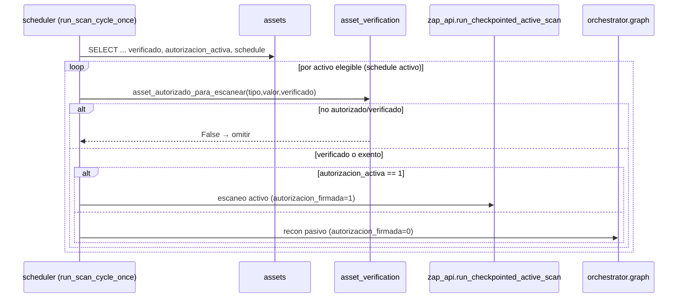

# Design: Endurecimiento para producción (Fase 6)

> Documento técnico. Organizado por los tres bloques/sub-changes de
> `proposal.md`. Cada decisión reusa infraestructura ya construida — Fase 6
> no inventa capacidades, cierra cables sueltos.

## Contexto verificado en el código (no asumido)

- `agents/_llm.py::call_claude` ya resuelve 3 backends (Anthropic API / CLI
  `claude -p` / OpenAI API) vía `_resolve_provider()`. **No mide costo hoy**:
  no cuenta tokens ni persiste nada. Los 7 call sites lo invocan como
  `call_claude(system, user)` sin tocar `model`.
- `api/scheduler.py::run_scan_cycle_once` hoy fuerza
  `autorizacion_firmada=False` (siempre pasivo) y lo documenta como
  bloqueado por falta de autorización persistente. Fase 0 **ya cerró ese
  bloqueo**: `assets.autorizacion_activa/_doc_url/_por/_en` existen en
  `db/schema.sql`. `tools/zap_api.py::run_checkpointed_active_scan` ya
  existe y se usa desde `POST /scan/activo`.
- `assets` ya tiene `verificado`, `verification_token`,
  `verification_method` y `verified_at`; `tools/asset_verification.py`
  implementa DNS-TXT y HTTP-file completos; `POST /assets/{id}/verify` y
  `GET /assets` (con `instrucciones_verificacion`) ya responden. Onboarding
  = **solo UI**.
- `subscriptions` (tenant_id, plan, wompi_subscription_id, estado,
  renovacion_en) ya existe; planes `trial/costero/flota/armada` en el CHECK
  de `tenants.plan`. Env `WOMPI_*` existen pero **inertes a propósito**.
- `tools/report_export.py::markdown_to_pdf_bytes / markdown_to_docx_bytes`
  ya generan PDF/DOCX sin binarios de sistema; `GET /kpis` (fase2c) agrega
  MTTR/%SLA/tendencia. Export ejecutivo = agregación + reuso.

---

## Bloque 6a — Operación en producción

### Decisión 6a.1 — Monitoreo de costo: envolver, no reescribir `call_claude`

**Opciones consideradas:**
- **A. Cambiar la firma de `call_claude`** para devolver también metadata de
  uso. Rechazada: rompe los 7 call sites y su contrato documentado.
- **B. Registrador interno con contexto por variable de entorno de
  request** (contextvar). Elegida.

`call_claude` setea un `contextvars.ContextVar` con `{tenant_id, scan_id}`
al inicio de cada scan (el orquestador/endpoint lo puebla), y tras cada
`_call_via_api`/`_call_via_openai_api` exitoso registra en `llm_usage`. Los
tokens salen de la respuesta de LangChain (`response.usage_metadata` /
`response_metadata` — ambos proveedores lo exponen vía `langchain_core`).
El costo se calcula con una tabla de tarifas por model id (las mismas
documentadas en `docs/despliegue.md`: Sonnet `$3/$15`, `gpt-5.4-mini`
`$0.75/$4.50` por millón in/out).

**CLI (`_call_via_cli`)**: `claude -p` no devuelve conteo de tokens →
`costo_estimado=null`, `provider="cli"`. Se registra la llamada pero
marcada "no medible", nunca un número inventado (Requirement del spec).

**Por qué contextvar y no pasar `tenant_id` como parámetro:** evita tocar
los 7 call sites y es seguro con el modelo de ejecución actual (cada scan
corre en su propio thread — ver `POST /scan/activo` en un
`threading.Thread`; contextvars se propagan por thread correctamente).

### Decisión 6a.2 — Tabla `llm_usage` (portable SQLite→Postgres)

Sigue el patrón de `db/schema.sql` (TEXT PK, UUID en Python, `tenant_id`
denormalizado, timestamps `CURRENT_TIMESTAMP`) y **reconciliación de DB
existente en `db/connection.py`** — pero como es una **tabla nueva**,
`CREATE TABLE IF NOT EXISTS` alcanza en ambos motores (no requiere el
`ALTER TABLE ADD COLUMN` manual que sí necesitaron las columnas de Fase 0;
ver el comentario de `db/connection.py` líneas 122-124).

```sql
CREATE TABLE IF NOT EXISTS llm_usage (
    id                TEXT PRIMARY KEY,
    tenant_id         TEXT NOT NULL REFERENCES tenants(id) ON DELETE CASCADE,
    scan_id           TEXT REFERENCES scans(id) ON DELETE SET NULL,
    provider          TEXT NOT NULL,          -- 'anthropic' | 'openai' | 'cli'
    model             TEXT NOT NULL,
    tokens_in         INTEGER,
    tokens_out        INTEGER,
    costo_estimado    REAL,                   -- USD; NULL si no medible (CLI)
    created_at        TIMESTAMP NOT NULL DEFAULT CURRENT_TIMESTAMP
);
CREATE INDEX IF NOT EXISTS idx_llm_usage_tenant_id ON llm_usage(tenant_id);
CREATE INDEX IF NOT EXISTS idx_llm_usage_scan_id ON llm_usage(scan_id);
```

`GET /costos` agrega con SQL directo (`SUM(costo_estimado) GROUP BY
scan_id`), scoped por `tenant_id` — mismo patrón de agregación que `GET
/kpis`.

### Decisión 6a.3 — Escaneo activo programado: ramificar el ciclo por columna

`run_scan_cycle_once` amplía su `SELECT` a `autorizacion_activa` y, por
activo que pase el gate de verificación ya existente
(`asset_autorizado_para_escanear`), decide:

- `autorizacion_activa == 1` → `run_checkpointed_active_scan(...)` y persiste
  el scan con `autorizacion_firmada=1`.
- si no → recon pasivo como hoy (`grafo.invoke` con `autorizacion_firmada=
  False`).



**Seguridad:** el gate es la columna persistida, nunca un booleano de
request — es lo que la Fase 0 habilitó y lo que el docstring viejo de
`scheduler.py` pedía. Mantener también el gate de `verificado` existente
(defensa en capas: un activo con `autorizacion_activa=1` pero `verificado=0`
igual se omite).

### Decisión 6a.4 — Programación por activo: columnas en `assets`, no tabla nueva

Frecuencia y pausa son atributos 1:1 del activo → dos columnas en `assets`
en vez de una tabla `scan_schedules` (evita un JOIN por ciclo y una tabla
extra para un dato de cardinalidad 1). **Requiere el patrón de
reconciliación manual de Fase 0** (SQLite no acepta `ADD COLUMN IF NOT
EXISTS`): agregar `_ensure_sqlite_assets_scheduling_columns(conn)` gemelo de
`_ensure_sqlite_assets_autorizacion_columns` y la rama Postgres con `ADD
COLUMN IF NOT EXISTS`.

```sql
-- en el CREATE TABLE de assets (schema.sql) + reconciliación en connection.py
scan_frequency_hours  INTEGER,              -- NULL → usa intervalo global
scan_paused           INTEGER NOT NULL DEFAULT 0
```

El scheduler global sigue corriendo cada `VIGIA_SCAN_INTERVAL_HOURS`; en
cada tick, por activo, decide correr o saltar según `scan_frequency_hours`
vs. el `created_at` del último scan de ese activo (o un `last_scanned_at`
si se agrega). CRUD vía `PATCH /assets/{id}` extendido (aditivo) o un
`PUT /assets/{id}/schedule` dedicado — decisión de implementación en tasks.

**Open question (para el spike de `sdd-apply`):** ¿mover a jobs por-activo
de APScheduler (`add_job` por asset) en vez de un job global que filtra?
Trade-off: jobs por-activo son más precisos pero hay que re-sincronizarlos
al crear/borrar/pausar activos. Se recomienda empezar con el job global que
filtra (menos superficie) y solo migrar si la precisión de frecuencia lo
exige.

---

## Bloque 6b — Facturación Wompi (GATED)

> **Diseño documentado, implementación en pausa.** No correr `sdd-apply` de
> este bloque sin un "sí" explícito del usuario en chat (`HANDOFF.md` 165).

### Decisión 6b.1 — Checkout server-side, secreto nunca al cliente

`POST /billing/checkout` (autenticado) valida el plan contra el CHECK ya
existente (`costero|flota|armada`), crea/actualiza la referencia con la
`WOMPI_PRIVATE_KEY` **solo en el backend**, marca `subscriptions.estado=
pendiente`, y devuelve al cliente únicamente la `WOMPI_PUBLIC_KEY` + la
referencia de pago. Nunca se expone la private key ni se confía en el plan
que el cliente diga tener.

### Decisión 6b.2 — Webhook con verificación de firma obligatoria

`POST /billing/webhook` (sin auth JWT — lo llama Wompi) verifica la firma
del evento con `WOMPI_EVENTS_SECRET` **antes** de tocar nada. Firma
inválida → 4xx sin efecto. Firma válida → actualiza
`subscriptions.estado`/`plan`/`renovacion_en` y `wompi_subscription_id`. Es
el único camino que transiciona a `activa` (el cliente no puede
auto-activarse). Idempotencia por id de transacción de Wompi.

```mermaid
sequenceDiagram
    participant U as Usuario
    participant API as api/main.py
    participant W as Wompi
    U->>API: POST /billing/checkout {plan}
    API->>API: valida plan; estado=pendiente
    API-->>U: public_key + referencia
    U->>W: paga (redirect/widget)
    W->>API: POST /billing/webhook {evento, firma}
    API->>API: verifica firma (WOMPI_EVENTS_SECRET)
    alt firma válida y aprobado
        API->>API: subscriptions.estado=activa, plan, renovacion_en
    else firma inválida
        API-->>W: 4xx (sin cambio)
    end
```

**Rollback específico:** eliminar ambas rutas deja los env `WOMPI_*`
inertes exactamente como están hoy — cero efecto colateral.

---

## Bloque 6c — Onboarding y export ejecutivo

### Decisión 6c.1 — Onboarding: orquestar la lógica existente, no duplicarla

El wizard es **frontend puro** sobre endpoints que ya responden: lee
`GET /assets` (trae `instrucciones_verificacion` cuando el asset no está
verificado ni exento), muestra el TXT/archivo a publicar, y llama
`POST /assets/{id}/verify` con el método elegido. Un resultado negativo del
backend (token no propagado) se muestra tal cual, con reintento — no se
reimplementa ninguna verificación en el cliente. Al verificarse, encadena
al siguiente paso de valor (autorizar escaneo activo → 6a). No requiere
endpoint nuevo salvo, opcionalmente, un `GET /onboarding/estado` de
conveniencia que resuma qué falta por tenant (decisión de tasks).

### Decisión 6c.2 — Export ejecutivo: agregar sobre lo existente, reusar el renderer

`GET /reports/ejecutivo/download?formato=pdf|docx` construye un markdown
consolidado en el backend: por cada activo del tenant, su postura (conteo
de hallazgos abiertos por severidad desde `findings`), más un encabezado
con los KPIs de `GET /kpis` (MTTR, %SLA, tendencia). Ese markdown pasa por
`markdown_to_pdf_bytes`/`markdown_to_docx_bytes` (ya probados) y se devuelve
como `FileResponse`/`Response`, mismo patrón que
`GET /scans/{id}/report/download` y `GET /reports/cumplimiento/download`
(validación `formato in ('pdf','docx')` → 422, ya establecida).

**Decisión de reuso:** la agregación de KPIs se toma llamando a la misma
capa que sirve `GET /kpis` (no se recalcula en paralelo) para no divergir de
fase2c. Si hace falta un helper de composición markdown multi-activo, vive
junto a `tools/report_export.py` (no en `vigia_core_private/` — es
formato/infra, no prompt de razonamiento).

---

## Consideraciones transversales

- **Open-core:** Fase 6 es 100% infraestructura/UI. **No toca
  `vigia_core_private/`** (sin prompts, sin mapeo ISO/Ley). Confirmado
  contra `docs/open-core.md` y `openspec/config.yaml`.
- **Portabilidad DB:** `llm_usage` = `CREATE TABLE IF NOT EXISTS` (basta en
  ambos motores). Columnas nuevas en `assets` (scheduling) = requieren el
  patrón dual de `db/connection.py` (SQLite `ADD COLUMN` manual idempotente
  vía introspección + Postgres `ADD COLUMN IF NOT EXISTS`).
- **Conflicto con changes hermanos:** `api/main.py` y el frontend son
  editados por varios changes en paralelo. Mitigación: endpoints/archivos
  nuevos aditivos; el split en 3 sub-changes reduce el tamaño de cada diff;
  el orquestador secuencia el `sdd-apply` para que dos changes no editen el
  mismo archivo a la vez.
- **Tests:** pytest para el registro de `llm_usage` (con LLM mockeado), la
  ramificación activo/pasivo del scheduler (con ZAP mockeado), la
  agregación de `GET /costos`, el gate de firma del webhook (6b), y el
  export ejecutivo. Frontend sin tests (no hay infra de test de frontend —
  ver `openspec/config.yaml`).
